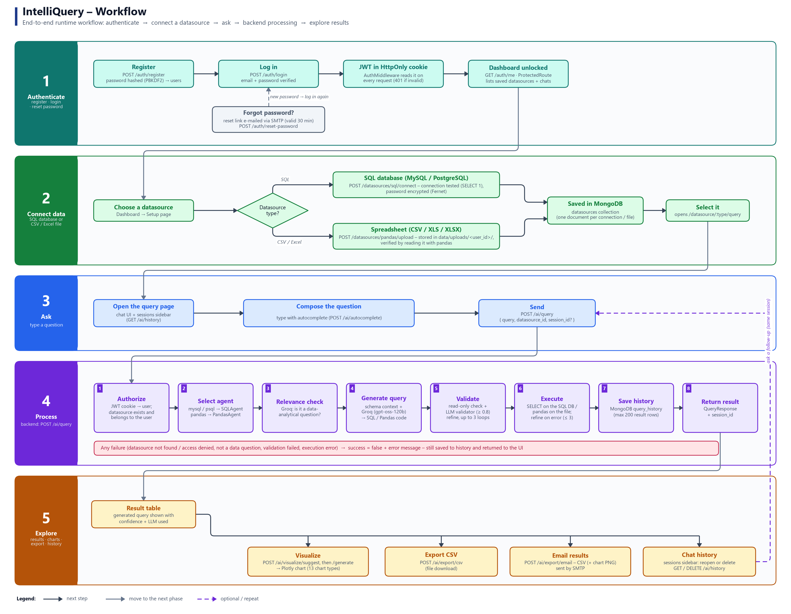
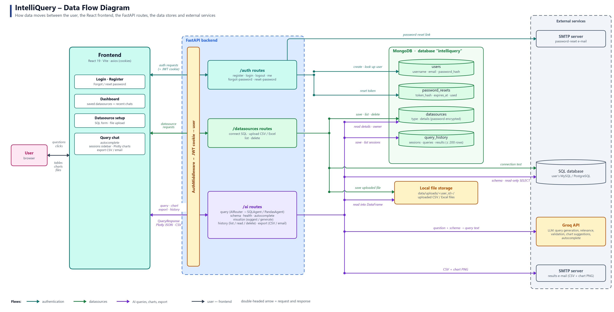

# IntelliQuery

IntelliQuery is a conversational analytics platform. Ask a question in plain English about a **MySQL / PostgreSQL database** or an uploaded **CSV / Excel file** and get back a result table, the generated query (so you can check it), and optional charts. A FastAPI backend routes each question to a SQL or Pandas agent, uses Groq-hosted LLMs to generate and validate the query, runs only read-only operations, and keeps a chat history per user.

## Features

- **Natural language to SQL / Pandas.** One endpoint (`POST /ai/query`) serves MySQL, PostgreSQL and CSV / Excel datasources; the AI router picks `SQLAgent` or `PandasAgent` from the datasource type.
- **Read-only by design.** Generated SQL must be a `SELECT` / `WITH` statement without write keywords; generated Pandas code is checked against forbidden patterns and the Python AST and runs in a restricted namespace.
- **Self-correcting.** A second LLM validates each generated query (accepted at confidence >= 0.8) and the query is refined up to 3 times; execution errors are also repaired by the LLM and retried (up to 3 attempts).
- **Relevance guardrail.** Questions that are not about data (greetings, general knowledge, coding help) are answered with a request to ask a data-related question.
- **Autocomplete.** Schema-aware, LLM-generated suggestions while typing (cached for 5 minutes).
- **Charts.** The LLM suggests chart types for a result and 13 Plotly chart types can be generated.
- **Export.** Download results as CSV or e-mail them (CSV plus an optional chart image) over SMTP.
- **Chat history.** Every question and answer is stored per session and can be reopened or deleted.
- **Accounts and security.** Registration / login with PBKDF2 password hashing, JWT in an HTTP-only cookie, e-mailed password reset, Fernet-encrypted datasource passwords, and an ownership check on every datasource.

## Architecture





More diagrams (all generated from the current code):

- [ER diagram](ER%20diagram.png) - the four MongoDB collections (`users`, `password_resets`, `datasources`, `query_history`)
- [UML class diagram](UML.png) - controller, AIRouter, agents, services and schemas
- [Activity diagram](Activity.png) - what happens during `POST /ai/query`, including the failure path and retry loops
- [Sequence diagram](sequence.png) - message-by-message flow of a question

## Tech Stack

- **Frontend:** React 19, Vite, Tailwind CSS v4, React Router, Axios (cookie credentials), Plotly.js / react-plotly.js.
- **Backend:** FastAPI + Uvicorn, Pydantic, Starlette middleware (CORS and JWT cookie authentication).
- **Data:** MongoDB (PyMongo) for users, reset tokens, datasources and chat history; SQLAlchemy with PyMySQL / psycopg2 for the user's SQL databases; Pandas + openpyxl for CSV / Excel files.
- **AI:** Groq SDK - `openai/gpt-oss-120b` (generation, relevance check, refinement, chart suggestions, autocomplete) and `llama-3.3-70b-versatile` (query validation).
- **Charts and export:** Plotly (Express and Graph Objects), Kaleido (chart images for e-mail), smtplib.
- **Security:** Passlib (PBKDF2-SHA256), PyJWT, cryptography (Fernet).

## Getting Started

### Prerequisites

- Python 3.10+ and Node.js 18+
- A running MongoDB (local or remote)
- A Groq API key (https://console.groq.com)
- Optional: a MySQL / PostgreSQL database to query, and SMTP credentials for e-mail features

### Backend

```bash
cd backend
python -m venv myvenv
source myvenv/bin/activate        # Windows: myvenv\Scripts\activate
pip install -r requirements.txt
# create backend/.env (see "Configuration" below)
uvicorn app:app --reload --host 0.0.0.0 --port 8000
```

### Frontend

```bash
cd frontend
npm install
npm run dev                       # http://localhost:5173
```

The frontend calls the API on port 8000 of the host it was loaded from; set `VITE_API_URL` to point it somewhere else.

## Configuration

Create `backend/.env`:

| Variable | Purpose |
| --- | --- |
| `AUTH_JWT_SECRET` | Secret used to sign JWTs (**required**) |
| `GROQ_API_KEY` | Groq API key (required for all AI features) |
| `MONGO_URI`, `MONGO_DB_NAME` | MongoDB connection (defaults: `mongodb://localhost:27017`, `intelliquery`) |
| `CORS_ORIGINS` | Extra allowed browser origins, comma-separated |
| `AUTH_TOKEN_EXPIRE_MINUTES`, `AUTH_REMEMBER_ME_EXPIRE_MINUTES` | Token lifetime (defaults: 60 and 43200) |
| `AUTH_COOKIE_NAME`, `COOKIE_SECURE`, `COOKIE_SAMESITE` | Session cookie settings |
| `FRONTEND_URL`, `PASSWORD_RESET_EXPIRE_MINUTES` | Link base URL and lifetime for password-reset e-mails (default 30 minutes) |
| `SMTP_HOST`, `SMTP_PORT`, `SMTP_USER`, `SMTP_PASSWORD`, `SMTP_FROM` | SMTP server for results and password-reset e-mails |

## Project Structure

```
backend/      FastAPI app: auth/, datasources/, ai/ (router, agents, llm, autocomplete, history), utils/
frontend/     React app: pages/, components/datasource/{common,sql,spreadsheet}, utils/api.js
*.png         Architecture diagrams (workflow, data flow, ER, UML, activity, sequence)
REPORT_README.md       Report-ready write-up of the system
IEEE_PAPER_README.md   Conference-paper draft
backend/*_GUIDE.md     Feature guides (autocomplete, Excel data, visualization)
backend/test_*.py      Scripted checks for autocomplete, Excel data, SQL normal form, visualization
```

## Literature Overview

Recent progress across both commercial tooling and academic research motivates IntelliQuery:

- **Commercial conversational BI.** Products such as BlazeSQL, DataGPT, and Google Looker Conversational Analytics prove that NL-powered querying lowers the entry barrier to data exploration. Their focus remains tightly coupled to SQL warehouses, they are closed-source, and they rarely expose extensibility hooks for hybrid backends. Teams that juggle relational databases and ad-hoc spreadsheets still need parallel workflows.
- **Text-to-SQL research.** Benchmarks like WikiSQL, Spider, and BIRD have established a rigorous evaluation regime for mapping natural language to SQL. Transformer-class models (GPT, LLaMA, Mistral) consistently push state of the art in compositional generalization, prompting robust query planners that handle joins, nested filters, and schema grounding. Yet these contributions stop at SQL generation and do not tackle execution safety, post-processing, or visualization.
- **Agent frameworks and tool orchestration.** Platforms such as LangChain enable LLM agents to call databases, APIs, and analytical runtimes, but most reference implementations target SQL-only workloads. Unified handling of SQL and Pandas (Excel / CSV) remains underexplored, especially when coupled with read-only guarantees and per-user governance.

IntelliQuery addresses these gaps by pairing datasource-aware agent routing with layered query validation, secure execution adapters, and built-in visualization and export.
